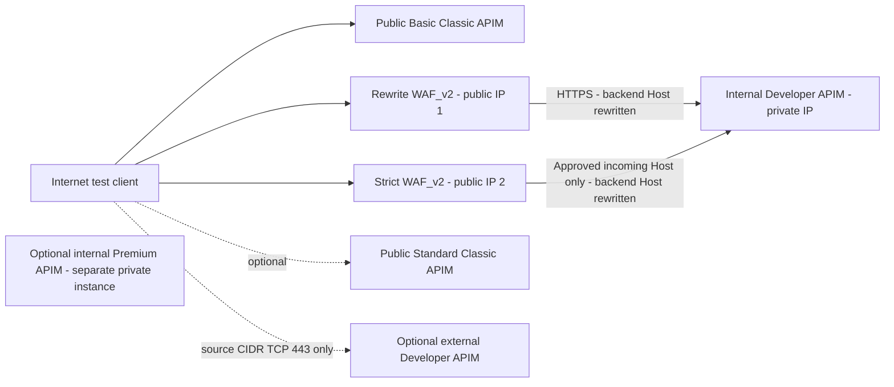

# Network paths, control boundaries and telemetry



The two WAF resources are **independent Application Gateways**, not alternate listeners on one gateway. Each has one basic HTTPS listener, one public Standard IP, one gateway subnet, one global WAF policy, and one backend route to the same internal Developer APIM. They use the same supplied frontend certificate and approved hostname; `curl --resolve` selects which public IP receives the connection.

Both backend settings override Host to APIM's **default gateway hostname**, use HTTPS port 443 and a private-IP backend pool, and probe `/lab/health` with the correct Host and positive body. The backend hostname also provides the name used for backend TLS SNI/certificate verification. No APIM custom domain/certificate upload is needed; its default certificate is publicly trusted by Application Gateway. No public DNS record or private DNS zone is required for these specific gateways because their backend pool uses the private IP with an explicit hostname. Other internal clients would need their own DNS/resolve arrangement **and** a permitted NSG source.

## What is actually different

The **rewrite** policy has no custom Host rules, but still runs OWASP 3.2 in Prevention mode. Rewriting the backend Host helps route an otherwise-unrecognized incoming Host to a healthy APIM API; it does **not** validate the original incoming Host.

The **strict** policy adds priority-1 `BlockUnapprovedIncomingHost`: inspect `RequestHeaders` selector `Host`, transform to lowercase, use negated `Equal` against the approved hostname and its `:443` form, action `Block`. There are no custom Allow rules that could short-circuit evaluation. Global policy association covers the gateway's only listener/route. SNI is not required by the listener and is not matched by this Host rule.

The policy returns HTTP 403 with a base64-encoded custom block body (`APIM-LAB-EDGE-DENIED` for strict; a different marker for rewrite managed-rule blocks). ARM requires base64 **in the template**, but clients receive the **decoded text**. A policy block marker is not a per-rule identifier: managed-rule blocks in the strict policy receive the same marker. Verify the Host custom rule in WAF logs rather than asserting every marker proves that rule fired.

## VNet and NSG boundaries

The VNet is `10.42.0.0/16`. Gateway subnets are `.0.0/24` and `.1.0/24`; internal Developer, optional Premium, and optional external Developer use `.2.0/24`, `.3.0/24`, and `.4.0/24`. Each APIM subnet has its own NSG, no delegation, and a Storage service endpoint. APIM Classic Basic/Standard remain outside the VNet.

| Inbound APIM rule | Priority | Scope |
| --- | --- | --- |
| Allow platform management | 100 | `ApiManagement` service tag to subnet TCP 3443 |
| Preserve platform HTTPS/management probes | 103 | `AzureLoadBalancer` service tag to TCP 443 and 3443 |
| Deny other management | 105 | All other sources to TCP 3443, before default VNet allow |
| Allow APIM infrastructure probe | 110 | `AzureLoadBalancer` to TCP 6390 |
| Allow approved HTTPS sources | 120 | Gateway subnets for internal instances; operator source CIDR for external instance |
| Deny other HTTPS | 130 | All other sources to TCP 443, before default VNet allow |
| Deny public HTTP | 140 | Internet to TCP 80 |

Gateway NSGs allow Internet TCP 443, `GatewayManager` TCP 65200-65535, and Azure load-balancer probes. There are no custom deny-outbound rules, UDRs or forced tunneling. Azure-provided DNS and default outbound NSG rules retain APIM/AppGw dependencies: DNS 53, Storage 443, SQL 1433, Key Vault 443, Entra ID 443, Azure Monitor 1886/443, certificate-chain/revocation HTTP(S), NTP and platform endpoints. This is **inbound isolation**, not an egress-hardening reference architecture. Adding outbound denies without the full [dependency list](https://learn.microsoft.com/en-us/azure/api-management/virtual-network-reference) can break provisioning or telemetry.

The explicit HTTPS/management probe allowance preserves platform reachability otherwise shadowed by the higher-priority deny rules: the default `AllowAzureLoadBalancerInBound` rule runs later. During live validation, management requests failed with HTTP 422 until this scoped platform allowance was added. It does not allow Internet clients or other VNet clients through the HTTPS/management denies.

`publicNetworkAccess: Enabled` is retained for Classic APIM configurations; it is not being used as a "private gateway" assertion. Internal `virtualNetworkType` determines private data-plane placement. Platform management access on 3443 and other provider infrastructure must be distinguished from API traffic on 443. Application Gateway does **not** expose APIM management/portal listeners in this lab.

## Telemetry and correlation

All instances send resource-specific diagnostic logs/metrics to one Log Analytics workspace: **AGWAccessLogs**, **AGWFirewallLogs**, and **ApiManagementGatewayLogs**. The mock API's Azure Monitor diagnostic samples at 100%, explicitly logs `X-Frontend-Validation-Id`, `x-appgw-trace-id`, and `x-original-host` request headers and `X-Lab-Request-Id` responses, and logs **zero body bytes**. The return-response policy echoes the probe ID without calling a real downstream backend.

Edge logs do not expose arbitrary client request headers. Correlate edge requests with timestamp, client IP and a **unique query token**, then use WAF/access `TransactionId` to join those tables. Use the validator's per-probe `RequestId` to search APIM's configured header log. To get an edge-searchable token, add a fresh harmless query to the validator path, for example `/lab/health?run=unique-lab-token`; the mock operation still matches `/health`. The run token groups the probes, while per-probe IDs distinguish APIM arrivals. Account for probe traffic, clock windows and ingestion delays.

Application Gateway also injects `x-appgw-trace-id`, which can correlate its forwarded request with edge `TransactionId`; normalize case/GUID hyphens and validate the mapping on a known positive control before joining. `x-original-host` preserves the incoming Host while the backend Host is rewritten. Treat client/proxy header values as diagnostic context, not authentication. WAF checks occur before backend Host override; when no backend is healthy, WAF evaluation may not occur at all, reinforcing the need for backend-health/positive-control checks.

Example resource-specific queries (replace synthetic values and run queries separately):

```kusto
AGWAccessLogs
| where TimeGenerated > ago(1h)
| where OriginalRequestUriWithArgs contains "run=unique-lab-token"
    or RequestQuery contains "run=unique-lab-token"
| project TimeGenerated, TransactionId, ClientIp, OriginalHost, Host,
          OriginalRequestUriWithArgs, RequestQuery, HttpStatus, ServerRouted, ServerStatus
| order by TimeGenerated asc
```

```kusto
AGWFirewallLogs
| where TimeGenerated > ago(1h)
| where RequestUri contains "run=unique-lab-token"
| project TimeGenerated, TransactionId, Hostname, RequestUri, Action, RuleId, Message
| order by TimeGenerated asc
```

```kusto
ApiManagementGatewayLogs
| where TimeGenerated > ago(1h)
| where Url contains "run=unique-lab-token"
| project TimeGenerated, CorrelationId, Url, RequestHeaders, ResponseCode, LastErrorReason
| order by TimeGenerated asc
```

```kusto
ApiManagementGatewayLogs
| where TimeGenerated > ago(1h)
| where tostring(RequestHeaders) contains "replace-with-probe-RequestId-from-JSON"
| project TimeGenerated, CorrelationId, Url, RequestHeaders, ResponseCode
```

A positive marker proves the mock policy executed, not a real downstream call. A strict WAF block with the correct custom rule, no backend route/status, and no corresponding APIM arrival provides stronger non-forwarding evidence **only when collection completeness is established**. Confirm that surrounding positive controls appear in all expected logs, sampling remains 100%, ingestion has completed, no data cap was reached, the right resources/time windows were queried, and no alternate listener/direct public route exists. Missing logs alone do not prove a block; workspace caps/delays and platform telemetry gaps can make the conclusion inconclusive. A configured 100% sample rate is not a delivery guarantee.

## Microsoft references

- [APIM VNet concepts and SKU support](https://learn.microsoft.com/en-us/azure/api-management/virtual-network-concepts)
- [Internal APIM VNet mode](https://learn.microsoft.com/en-us/azure/api-management/api-management-using-with-internal-vnet)
- [APIM injection resource requirements](https://learn.microsoft.com/en-us/azure/api-management/virtual-network-injection-resources)
- [APIM network dependencies and ports](https://learn.microsoft.com/en-us/azure/api-management/virtual-network-reference)
- [Internal APIM with Application Gateway](https://learn.microsoft.com/en-us/azure/api-management/api-management-howto-integrate-internal-vnet-appgateway)
- [Application Gateway request processing and injected headers](https://learn.microsoft.com/en-us/azure/application-gateway/how-application-gateway-works)
- [WAF custom response and ARM base64 requirement](https://learn.microsoft.com/en-us/azure/web-application-firewall/ag/configure-custom-response-code)
- [WAF policy template reference](https://learn.microsoft.com/en-us/azure/templates/microsoft.network/2024-05-01/applicationgatewaywebapplicationfirewallpolicies)
- [APIM monitoring and collection settings](https://learn.microsoft.com/en-us/azure/api-management/monitor-api-management)
- [API diagnostic schema](https://learn.microsoft.com/en-us/azure/templates/microsoft.apimanagement/2024-05-01/service/apis/diagnostics)
- [APIM logger schema (`azureMonitor` logger is explicitly created before API diagnostics)](https://learn.microsoft.com/en-us/azure/templates/microsoft.apimanagement/2024-05-01/service/loggers)
- [AGWAccessLogs columns](https://learn.microsoft.com/en-us/azure/azure-monitor/reference/tables/agwaccesslogs)
- [AGWFirewallLogs columns](https://learn.microsoft.com/en-us/azure/azure-monitor/reference/tables/agwfirewalllogs)
- [ApiManagementGatewayLogs columns](https://learn.microsoft.com/en-us/azure/azure-monitor/reference/tables/apimanagementgatewaylogs)
